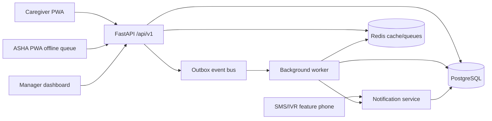
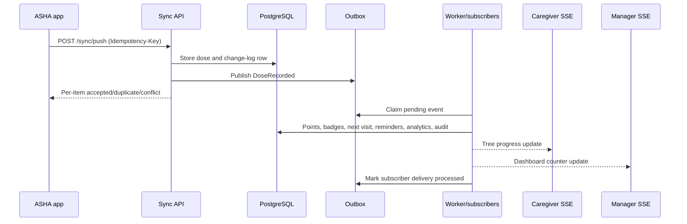
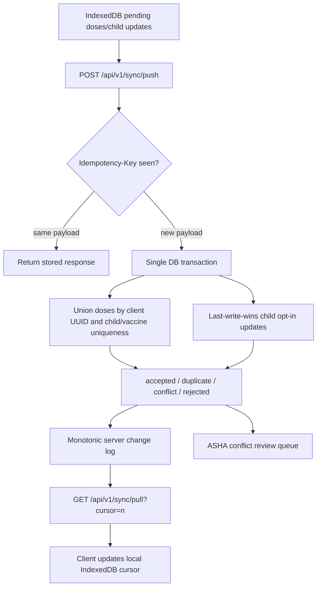
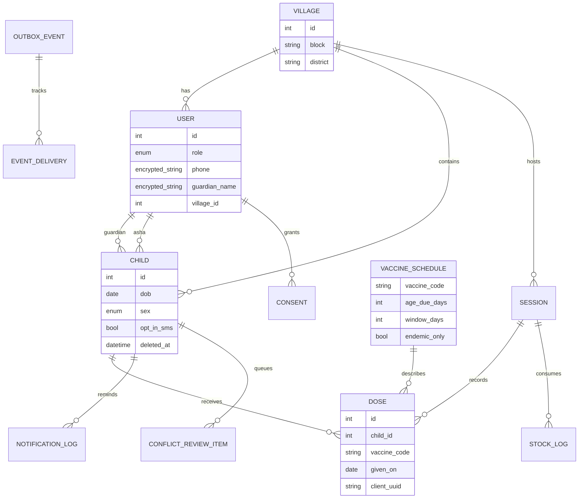

# Teeka Yatra Architecture

Teeka Yatra is a privacy-preserving, offline-first immunization platform for caregivers, ASHAs, programme managers, and admins. The backend is FastAPI with SQLAlchemy and Alembic, PostgreSQL in production, SQLite in tests, Redis for cache/job coordination, and an internal outbox-backed event bus.

## System View

## Event Flow

## Sync Flow

## Data Model

## Boundaries

- Routers expose HTTP contracts and dependency injection only.
- Services own business rules: schedule, gamification, analytics, notifications, privacy, sync, and events.
- Repositories own database queries and pagination/filtering details.
- Models define persistence, indexes, uniqueness, foreign keys, and soft deletion.
- Schemas define request validation and OpenAPI examples.
- Background jobs handle reminders, analytics refresh, leaderboards, retention, and register imports with retries/dead-letter logging.
