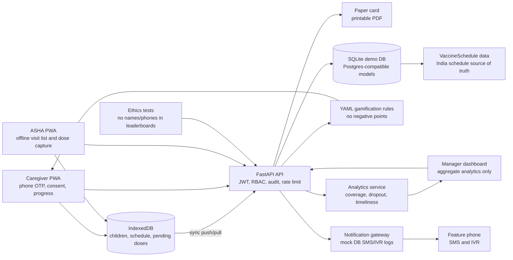
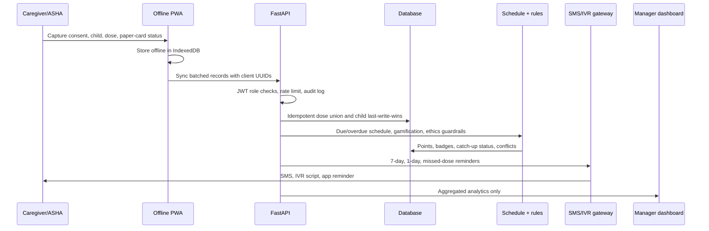

# Teeka Yatra

Teeka Yatra is a gamified child immunization ecosystem for India. It supports caregivers, ASHA health workers, programme managers, and admins while keeping privacy, inclusion, catch-up care, and paper fallback at the center.

## Architecture



## Data Flow



Capture starts in the caregiver or ASHA experience. The frontend stores child records, schedule rows, and pending doses in IndexedDB so visits work offline. Sync sends client UUIDs and timestamps to the backend, where duplicate pushes are idempotent, child metadata uses last-write-wins, and duplicate dose conflicts are flagged for ASHA review. Schedule, gamification, analytics, and notifications then derive from database rows, not hardcoded business logic.

## Repository Layout

- `backend`: FastAPI, SQLAlchemy, Alembic, SQLite by default, Postgres-compatible models, pytest.
- `frontend`: React, Vite, TypeScript, Tailwind, Dexie IndexedDB, service worker PWA shell.
- `docs`: architecture, privacy, responsible-design, and SDG notes.
- `docker-compose.yml`: demo stack for API and frontend.
- `Makefile`: one-command demo and test helpers.

## Core Backend Capabilities

- India vaccination schedule stored in `vaccine_schedules`.
- `GET /children/{id}/schedule`: due, overdue, next visit, catch-up logic.
- `GET /children/{id}/progress`: points, level, streak, badges.
- `GET /leaderboard/village`: aggregate-only village leaderboard.
- `GET /analytics/manager`: aggregate programme metrics and mismatch alerts.
- `POST /sync/push` and `GET /sync/pull`: offline-first sync.
- `GET /children/{id}/card.pdf` and `GET /children/card-template.pdf`: printable A5 vaccination cards with QR containing only child ID.
- SMS/IVR reminder scheduler and `/sim` feature-phone inbox demo.
- JWT role checks, phone encryption, consent capture/withdrawal, audit logs, rate limiting.
- Data export/delete, grievances, retention job, ethics tests.

## Privacy And Responsible Design

See `docs/PRIVACY.md` for the data minimisation review. Highlights:

- Caregivers see only their own children.
- ASHAs see only assigned villages.
- Managers see aggregate data only.
- Phone numbers are encrypted at rest and masked in admin responses.
- Consent is purpose-scoped and can be withdrawn.
- Leaderboards never expose individual child names or phone numbers.
- Points rules are tested to ensure they cannot go negative.
- Late doses receive catch-up support, never penalties.

## Run With Docker

Prerequisites: Docker with Compose support and `make`.

```bash
make demo
```

This builds both services, runs Alembic migrations, seeds demo data, starts the FastAPI backend at `http://localhost:8000`, and starts the Vite frontend at `http://localhost:5173`.

Useful commands:

```bash
make stop
make reset-demo
make test
```

`make reset-demo` removes the Docker volume and starts from fresh seeded data.

## Run Locally Without Docker

Backend:

```bash
cd backend
python3 -m venv ../.venv
source ../.venv/bin/activate
pip install -r requirements.txt
alembic upgrade head
python -m app.seed
uvicorn app.main:app --reload
pytest
```

Frontend:

```bash
cd frontend
npm install
VITE_API_BASE=http://localhost:8000 npm run dev
```

## Demo Script

1. Start the demo:

   ```bash
   make demo
   ```

2. Open `http://localhost:5173`.

3. On the login screen:

   - Pick English, Hindi, or Punjabi.
   - Enter any demo phone number.
   - Tick the consent checkbox.
   - Use OTP `123456`.

4. Show the manager dashboard:

   - Coverage heat table by block.
   - Trend charts.
   - Mismatch alerts with suggested actions.
   - CSV export.
   - Consent/privacy panel with grievance form and local data export/delete demo.

5. Show backend API docs at `http://localhost:8000/docs`.

6. Generate a token for seeded users:

   ```bash
   curl -X POST "http://localhost:8000/auth/token?user_id=1"
   ```

   Demo user IDs:

   - `1` and `2`: ASHAs.
   - `3`: programme manager.
   - `4` onward: caregivers.

7. Show schedule and card generation with an authenticated token:

   ```bash
   curl -H "Authorization: Bearer TOKEN" http://localhost:8000/children/1/schedule
   curl -H "Authorization: Bearer TOKEN" http://localhost:8000/children/1/card.pdf --output card.pdf
   ```

8. Show feature-phone reminder simulator:

   - Open `http://localhost:8000/sim`.
   - Use `/sim/inbound?phone=...&message=STOP` to demonstrate opt-out.

9. Show responsible-design checks:

   ```bash
   make test
   ```

   The ethics tests fail the build if leaderboards expose names/phones or any points rule can be negative.

## API Surface

- `GET /health`
- `POST /auth/token`
- `POST /users`
- `GET /users`
- `GET /villages`
- `GET /schedule`
- `POST /consents`
- `POST /consents/{id}/withdraw`
- `POST /children`
- `GET /children`
- `GET /children/{id}`
- `GET /children/{id}/schedule`
- `GET /children/{id}/progress`
- `GET /children/{id}/card.pdf`
- `GET /children/card-template.pdf`
- `GET /me/data/export`
- `DELETE /me/data`
- `POST /grievances`
- `GET /grievances`
- `POST /jobs/data-retention`
- `POST /sync/push`
- `GET /sync/pull?since=...`
- `GET /analytics/manager`
- `GET /leaderboard/village`
- `GET /sim`
- `GET /sim/inbound?phone=...&message=STOP`
- `POST /sim/inbound`
- `GET /demo-summary`

## Design Principles

- No public shaming: only aggregate village/team competition.
- No monetary rewards: motivation uses badges and supportive progress.
- No late-dose penalties: catch-up receives positive support.
- Offline-first: ASHA and caregiver workflows survive poor connectivity.
- Low literacy: icon-first controls, read-aloud buttons, short labels.
- Feature-phone support: SMS and IVR scripts complement the PWA.
- Paper fallback: printable bilingual cards and blank templates.
